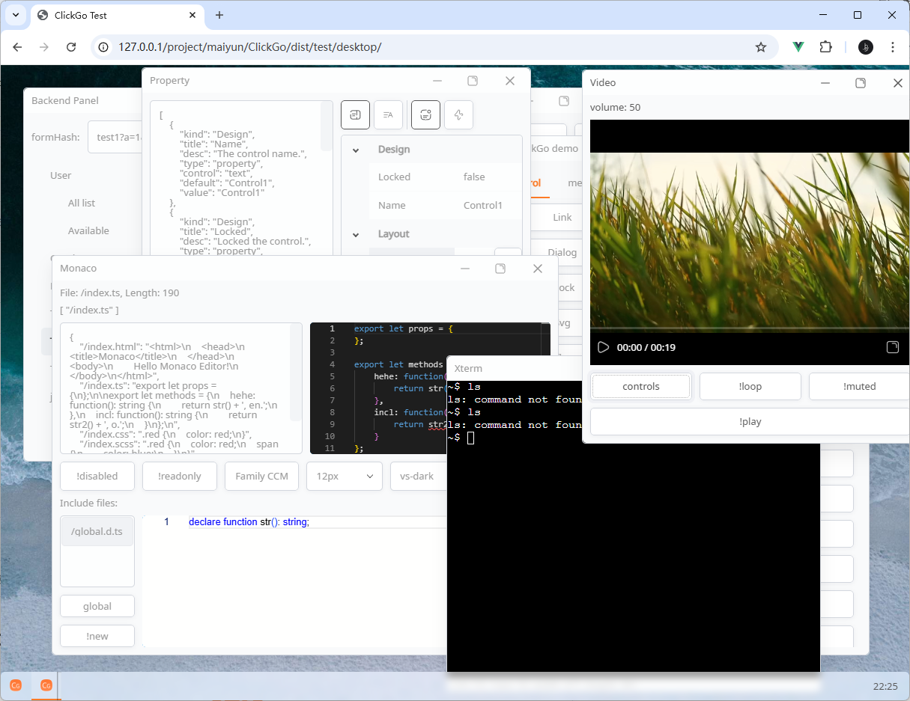
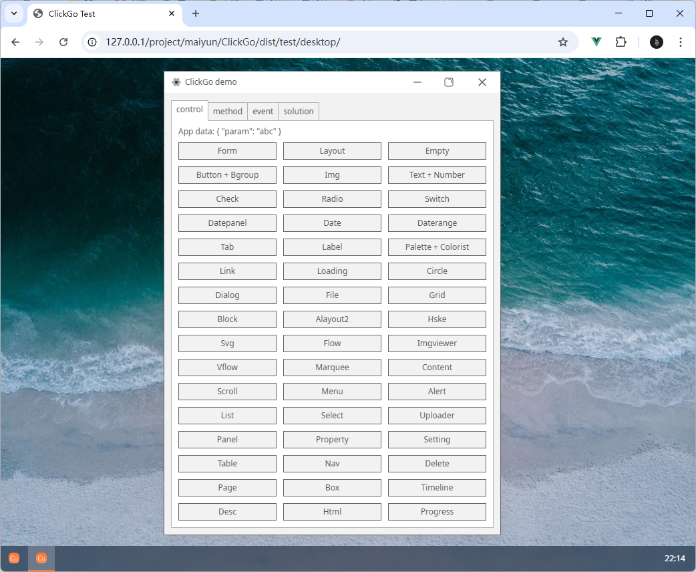

# ClickGo

<p align="center"></p>
<p align="center">
    <a href="https://github.com/maiyun/clickgo/blob/master/LICENSE">
        
    </a>
    <a href="https://www.npmjs.com/package/clickgo">
        
    </a>
    <a href="https://github.com/maiyun/clickgo/releases">
        
    </a>
    <a href="https://github.com/maiyun/clickgo/issues">
        
    </a>
</p>

[简体中文](./doc/README.sc.md)

Build web and native apps using HTML + CSS.

Applications can be compiled into a single cga file and run on the web or on the local system via [ClickGo Native](https://github.com/maiyun/clickgo-native). You can build applications such as image editors, database management tools and file browsers, as well as admin panels.

> Project statement: This project was first committed to GitHub on November 1, 2016. In 2026, it formally introduced AI-assisted development and adaptations for AI integration, but software engineers still lead, review, verify and test the project; it is not automatically generated by simply telling AI what we want. Non-Chinese content is translated with assistance from Byterun Translator, so the wording may have an AI-like tone.

> The releases on GitHub may be incomplete. For versions after 3.0.0, refer to NPM as the source of record: [NPM](https://www.npmjs.com/package/clickgo?activeTab=versions)

<p align="center">
    
    
    
</p>

## Installation

First, set the loading path for the ClickGo module, then import your entry file.

**index.html**

```html
<script type="importmap">
{
    "imports": {
        "clickgo": "https://cdn.jsdelivr.net/npm/clickgo@x.x.x/dist/index.js"
    }
}
</script>
<script type="module" src="index.js"></script>
```

It can also carry parameters and global variables.

```html
<script>
clickgo = {
    'config': {
        'cdn': 'https://cdn.jsdelivr.net',
    },
    'global': {},
};
</script>
```

## Usage

Use the [ClickGo Compiler](https://github.com/maiyun/clickgo-compiler) to compile the app folder into a cga file, then compile the entry file and reference it in the browser.

For splitting Forms in large applications, see [Local application components and Dock](./doc/sc/local-component.md).

Applications can use [shared commands](./doc/sc/commands.md) to connect buttons, menus, shortcuts, command palettes and AI interfaces to the same business execution logic. For the complete command registration, HTTP MCP, stdio and CLI integration workflow for desktop applications, see the [ClickGo Native Simplified Chinese documentation](https://github.com/maiyun/clickgo-native/blob/master/doc/README.sc.md).

**index.html**

```html
<script type="module" src="index.pack.js"></script>
```

**index.js**

```typescript
import * as clickgo from 'clickgo';
class Boot extends clickgo.AbstractBoot {
    public async main(): Promise<void> {
        await clickgo.task.run(this._sysId, 'xxx.cga');
    }
}
clickgo.launcher(new Boot());
```

### NPM

In a TypeScript environment, installing via NPM provides code completion.

```sh
$ npm i clickgo --save-dev
$ npm i jszip --save-dev
$ npm i vue --save-dev
```

## Notes

ClickGo automatically loads the Vue and jszip libraries, so **do not** include their JS or CSS files.

## Demo

Clone the code and visit "dist/test/index.html".

[Click here to visit online](https://maiyun.github.io/clickgo/dist/test/)

## License

ClickGo is released under the [Apache-2.0](./LICENSE) license.

For third-party licenses and attributions, see [Third-party licenses](./THIRD-PARTY-LICENSES.md).
